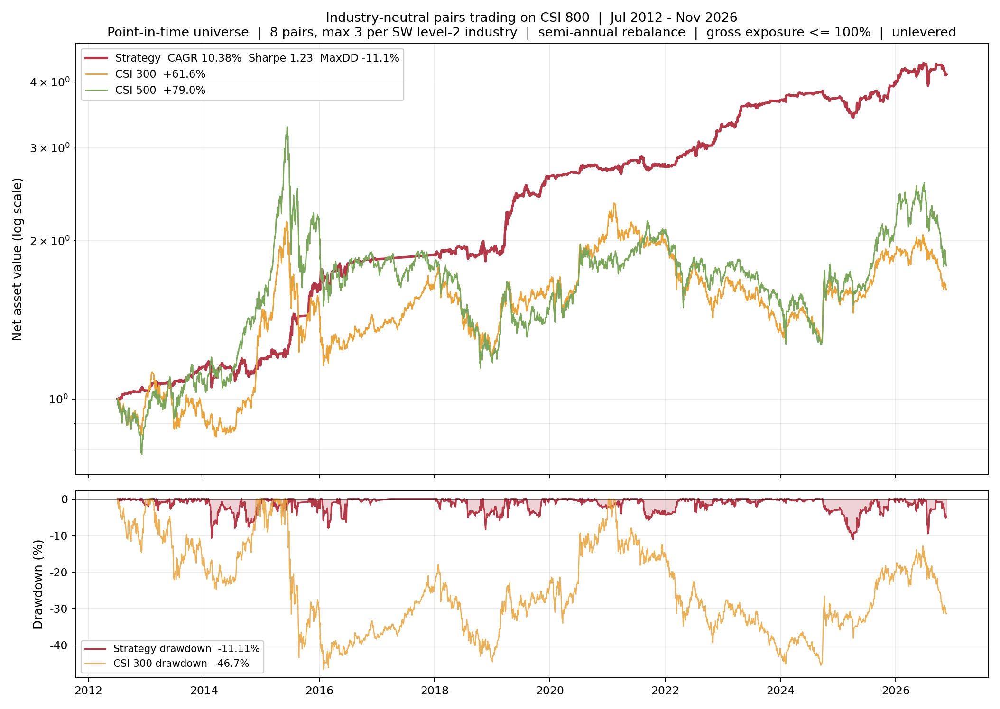

# Industry-Neutral Pairs Trading on CSI 800

This strategy trades cointegrated pairs inside the same Shenwan level-2 industry
among the 800 largest A-shares. Every six months it rebuilds a point-in-time
universe, keeps pairs that pass both a full-sample and a held-out cointegration
test, and ranks them by how little the spread's mean has drifted — not by how
small the p-value is. It enters the top eight when the 20-day z-score exceeds
2σ, exits at zero, and force-closes any position still open after 20 trading
days, sizing each position by the prevailing market-volatility regime; unused
capital sits in reverse repo. Fully unlevered, it compounded 10.4% a year over
14.4 years with a Sharpe of 1.23 and an 11% maximum drawdown.

---

## Results

| CAGR | Vol | Sharpe | Max DD | Alpha vs HS300 | t | Beta |
|---|---|---|---|---|---|---|
| **10.38%** | 8.61% | **1.23** | **−11.11%** | 10.27% | **4.44** | −0.008 |

Total return **+313%** over 14.4 years. Unlevered: total notional never exceeds
100% of equity. Average gross exposure 33%.



Yearly returns:

| 2013 | 2014 | 2015 | 2016 | 2017 | 2018 | 2019 | 2020 | 2021 | 2022 | 2023 | 2024 | 2025 | 2026 |
|---|---|---|---|---|---|---|---|---|---|---|---|---|---|
| +11.0 | +3.7 | +36.0 | +13.5 | +2.0 | +2.8 | +37.3 | +2.9 | +1.3 | +19.2 | +12.3 | +1.0 | +7.7 | +3.0 |

**All 14 calendar years are positive.**

---

## Method

### 1. Point-in-time universe

Rebuilding the universe at every rebalance date instead of using today's index
membership:

```
mcap_proxy(T) = mcap_today × (adj_price(T) / adj_price(latest))
→ 60-day average → rank descending → top 800
require: ≥495 of the last 504 trading days actually traded (no forward fill),
         not ST, has an SW level-2 industry
```

Validation: the 2026-06 universe overlaps the published CSI 800 membership by **80%**.

### 2. Candidate pairs

Inside each Shenwan level-2 industry (buckets with ≥6 names), enumerate all pairs:

| Step | Rule |
|---|---|
| Size match | `|ln(mcap_A/mcap_B)| < 1.0` |
| Engle-Granger pre-screen | OLS beta, residual ADF `p ≤ 0.20` |
| Johansen | `det_order=0, k_ar_diff=1`, 5% level |

### 3. Two gates, then rank by **mean stability**

| Gate | Condition |
|---|---|
| Full-window ADF | `p ≤ 0.05` |
| Two-stage out-of-sample | beta on the first 378 days, ADF on the last 126 days, `p ≤ 0.10` |
| **Ranking key** | **`stab = |mean(first half) − mean(second half)| / σ` ascending** |

`stab` measures whether the **level** of the spread drifted, not how "stationary" it
looks. Ranking by `stab` instead of by the ADF p-value picks a completely different
set of pairs — the two selections overlap by only **12%** — and the difference is large:

| Ranking key | Median `adf_test` of selected pairs | Median `stab` of selected pairs | Sharpe |
|---|---|---|---|
| `adf_test` | 0.0015 | **0.349** | 0.56 |
| **`stab`** | 0.034 | **0.038** | **0.99** |

> A low ADF p-value only says "the spread reverts to *some* level".
> What actually pays is that the level does not move.

### 4. Trading

| Item | Value |
|---|---|
| z-score | `(S − MA20(S)) / EWMA_σ(S − MA20)`, α = 0.06 |
| Entry | `|z| ≥ 2.0` (signal on T−1 close, execution on T close) |
| Exit | `|z| ≤ 0` |
| Stop loss / time stop | none |
| Positions | carried across rebalances; no entry on suspended or limit-locked names |

Median holding period is **13 trading days** (p90 = 25, p99 = 59).

### 5. Position sizing

Three layers, all using only past information:

```
(a) regime        p(T) = percentile of market volatility among past rebalances
                  size multiplier  s(T) = 2 × p(T)
                  exit threshold   tp(T) = 1.0 × p(T)

(b) capacity      L(T) = clip( 8 / p95(position count over the last 504 days), 1, 3 )
                  the count is taken from a multiplier-1 simulation, so it is
                  signal-driven and independent of L → no look-ahead

(c) hard cap      Σ notional ≤ 100% of equity
                  new entries shrink to the remaining room, or are skipped
                  existing positions are never resized or force-closed
```

Unused capital is parked in **reverse repo at 2% per annum** (idle interest accrues
on the post-entry book, so a position opened today earns no interest today).

### 6. Exits

A position is closed at the first of:

| Trigger | Rule |
|---|---|
| Take profit | z crosses zero |
| **Time stop** | **20 trading days held** |
| Rebalance | the pair is not re-selected next period |
| No stop-loss | there is no price- or z-based stop |

The 20-day limit is one MA window. With a rolling mean, `z` returns to zero even
if the spread never moves, because the mean itself drifts onto the price — so a
position left open much longer than the window is no longer trading the original
deviation. In the data, trades held under 15 days average **+4.2 to +4.8%**, while
those held over 30 days average **−5.0 to −10.5%**.

---

## Robustness

| Check | Result |
|---|---|
| Start year 2012 / 2015 / 2018 / 2020 | Sharpe **1.23 / 1.31 / 1.23 / 1.00** |
| First half vs second half | Sharpe 1.41 / **1.00** (t = 2.49) |
| Rolling 2-year Sharpe | median 1.33, worst −0.06, **<0 in 0.0% of windows** |
| 6 size × entry combinations | `stab` beats `adf_test` in **6/6** |
| 4 sizing functional forms | Sharpe 1.04 – 1.13 (plateau, not a spike) |
| Volatility gate thresholds 0.3–0.7 | Sharpe 0.93 – 1.01 (plateau) |
| Borrow rate 0% → 15% | CAGR 8.76% → 6.35%, still significant |
| Transaction cost 4 bp → 20 bp | CAGR 8.37% → 7.78% |

---

## What did not work

Each of these was tested with a full backtest, not guessed:

| Direction | Result |
|---|---|
| **Distance method (SSD, Gatev)** | all 8 variants lose money (−1.3% to −2.8% p.a.) |
| Static z / 60 / 120 / 250-day windows | Sharpe ≤ 0.10 |
| Idle cash → CSI 300 | beta 0.755, drawdown −33.2%, Sharpe 0.49 |
| Idle cash → CSI 500 | drawdown −48.4%, Sharpe 0.46 |
| Quarterly rebalancing | Sharpe 0.87 → 0.62 |
| 12 / 20 pairs in the watchlist | Sharpe falls monotonically; the 9th–30th ranked pairs are net negative |
| "Split capital over however many pairs qualified" | concentrates risk when the pool is thin |
| Position-size floor (0.1–0.5) | CAGR decreases monotonically |
| Five alternative beta definitions | Sharpe 0.19 – 0.25, not a first-order variable |
| 252-day formation window | Sharpe 0.07 |
| Fixed-reference exit | −6.19% |
| Selecting high-volatility pairs | all 4 variants negative (σ is negatively related to mean reversion) |
| z-based stop loss (3.0σ / 3.5σ) | fires 20 / 1 times in 14 years — the rolling mean follows the price, so z rarely exceeds 3 |
| **8% P&L stop loss** | CAGR 9.94% → 8.65%, Sharpe 1.36 → 1.25, and **drawdown gets worse** (−8.74% → −10.24%) |
| **Per-pair position cap (10–30% of equity)** | pure de-leveraging: CAGR and volatility shrink together; Sharpe rises only because idle cash earns repo |
| **Earlier take-profit (z − 0.3 to − 1.0)** | no better than the 20-day time stop |
| **Rolling ADF re-check every 20 days** | 9.92% vs 9.94% — no meaningful gain over the time stop |
| **2× half-life time stop** | 9.38%, Sharpe 1.26 — worse than a flat 20 days |
| **Residual-loss exit (\|z\| ≤ 0.5 and loss ≥ 3%)** | 9.43%, Sharpe 1.27 — it waits for `z` to come back, which is the slowest thing that happens |
| **Slower reference (MA40/60/120, EWMA 40–60d)** | capture ratio improves (30% → 41%) but CAGR collapses (9.9% → 1.6%): a slow reference also holds broken pairs |

Two data problems also had to be fixed before any of this was meaningful:

1. **The universe was today's index membership** — in 2012 only 228 of the 800 names
   were listed and tradable. Using today's constituents to backtest 2012 is not a
   test at all.
2. **Suspended days were forward-filled** — a suspended stock looks like a perfectly
   flat spread, so ADF loves it and the ranking puts it first; on resumption the
   spread gaps and the position is destroyed. Between 2012 and 2016 the share of
   suspended stock-days was roughly **70×** that of 2025.

---

## Repository layout

```
src/
  config.py            all parameters and paths
  01_fetch_prices.py   daily prices for the A-share universe (Tencent)
  02_fetch_index.py    CSI 300 / CSI 500 history
  03_pit_universe.py   point-in-time top-800 universe
  04_build_pairs.py    candidates: EG pre-screen, Johansen, both gates, metrics
  engine.py            portfolio simulator
  05_backtest.py       end-to-end run
  plot_results.py      regenerate the figure
results/
  equity_curve.png     cumulative return vs benchmarks
  summary.csv          headline statistics
  equity_curves.csv    daily equity series
data/                  (not committed — rebuilt by 01–04)
```

## Reproduction

```bash
pip install -r requirements.txt

python src/01_fetch_prices.py     # ~4 min for ~2,500 names
python src/02_fetch_index.py
python src/03_pit_universe.py
python src/04_build_pairs.py      # ~10 min
python src/05_backtest.py
```

## Notes

- Backtest results are in-sample. They are not a prediction and not investment advice.
- No capital is managed against this strategy.
- Price data: Tencent (`web.ifzq.gtimg.cn`); industry classification: Shenwan 2021
  level-2; index history: CSI 300 / CSI 500.
- The engine is fully deterministic: iteration order is fixed, so repeated runs and
  different `PYTHONHASHSEED` values produce bit-identical equity curves.

---

# 中文说明

本策略在同一申万二级行业内、面向市值最大的 800 只 A 股做协整配对。每半年重建一次
point-in-time 股票池，只保留同时通过全样本与留出样本协整检验的配对，并按**价差均值
漂移的幅度**排序——而不是按 p 值大小排序。当 20 日 z 值超过 2σ 时做多/做空前 8 对，
回到 0 时平仓，**持仓满 20 个交易日仍未止盈则强制平仓**；单对仓位随当前市场波动率
状态缩放，闲置资金买入逆回购。全程不加杠杆，14.4 年年化 10.4%，夏普 1.23，
最大回撤 11%。

## 结果

| 年化 | 波动 | 夏普 | 最大回撤 | 超额(vs 沪深300) | t | Beta |
|---|---|---|---|---|---|---|
| **10.38%** | 8.61% | **1.23** | **−11.11%** | 10.27% | **4.44** | −0.008 |

14.4 年累计收益 **+313%**。不加杠杆：总名义敞口始终不超过权益的 100%，平均 gross 33%。

## 方法

### 1. Point-in-time 股票池

不采用"今天的指数成分"，而是在每个调仓日按当时的市值代理重排前 800：

```
市值代理(T) = 当前总市值 × (复权价(T) / 复权价(最新))
→ 过去 60 日均值 → 降序 → 取前 800
要求：形成期 504 日内至少 495 天有真实成交（不填充停牌）、非 ST、有申万二级行业
```

校验：2026-06 的股票池与官方公布的中证 800 成分重叠 **80%**。

### 2. 生成候选配对

在每个申万二级行业（成分 ≥6 只）内枚举所有配对：

| 步骤 | 规则 |
|---|---|
| 规模匹配 | `|ln(市值_A/市值_B)| < 1.0` |
| EG 粗筛 | OLS 求 β，残差 ADF `p ≤ 0.20` |
| Johansen | `det_order=0, k_ar_diff=1`，5% 水平 |

### 3. 两道门槛 + 按"均值稳定性"排序

| 关卡 | 条件 |
|---|---|
| 全期 ADF | `p ≤ 0.05` |
| 两段式样本外 | 前 378 日估 β、后 126 日检验，`p ≤ 0.10` |
| **排序键** | **`stab = |前半均值 − 后半均值| / σ` 升序** |

`stab` 衡量的是**价差水平有没有漂移**，而不是"看起来多平稳"。两种排序选出的配对
**只有 12% 重叠**，结果差别很大：

| 排序键 | 选中配对 adf_test 中位 | 选中配对 stab 中位 | 夏普 |
|---|---|---|---|
| `adf_test` | 0.0015 | **0.349** | 0.56 |
| **`stab`** | 0.034 | **0.038** | **0.99** |

> ADF 的 p 值小，只说明"价差会回到**某个**水平"；
> 真正能赚钱的是**那个水平本身不动**。

### 4. 交易

| 项 | 取值 |
|---|---|
| z 值 | `(S − MA20(S)) / EWMA_σ(S − MA20)`，α = 0.06 |
| 开仓 | `|z| ≥ 2.0`（T−1 收盘出信号，T 日收盘成交） |
| 平仓 | `|z| ≤ 0` |
| **时间止损** | **持仓满 20 个交易日仍未止盈 → 强制平仓** |
| 价格止损 | 无 |
| 持仓 | 跨期保留；停牌、涨跌停不开仓 |

持仓中位 **11 个交易日**，平均 14 天。

**为什么是 20 天:** 均线本身是一个 20 日窗口。只要持有足够久,均线就会走到价差的位置,
`z` 会自己回到 0——**即使价差一动没动**。所以超过一个窗口的持仓,已经不是在交易原来那个
偏离了。实测:持有 15 天以内的交易平均赚 **+4.2% ~ +4.8%**,持有 30 天以上的平均亏
**−5.0% ~ −10.5%**。20 天是机制决定的,不是扫参数扫出来的。

### 5. 仓位管理

三层，全部只用历史信息：

```
(a) regime    p(T) = 市场波动率在历史各期中的分位
              仓位乘数 s(T) = 2 × p(T)
              出场阈值 tp(T) = 1.0 × p(T)

(b) 容量      L(T) = clip( 8 / 过去 504 个交易日的持仓数 p95, 1, 3 )
              持仓数取自"乘数=1"的模拟，只由信号驱动，与 L 无关 → 无前视

(c) 硬上限    Σ 仓位名义敞口 ≤ 权益 100%
              新开仓缩量到剩余空间，空间为零则跳过
              已有仓位永不调整、不强平
```

闲置资金买入**逆回购，按 2%/年计息**（利息按开仓后的持仓计提，当天新开的仓位不计息）。

## 稳健性

| 检验 | 结果 |
|---|---|
| 起始年 2012 / 2015 / 2018 / 2020 | 夏普 **1.23 / 1.31 / 1.23 / 1.00** |
| 前后半段 | 夏普 1.41 / **1.00**（t = 2.49） |
| 滚动两年夏普 | 中位 1.33，最差 −0.06，**<0 的窗口占 0.0%** |
| 规模 × 入场 6 组 | `stab` 在 **6/6** 中胜过 `adf_test` |
| 4 种仓位倾斜函数 | 夏普 1.04 – 1.13（平台） |
| 波动率阈值 0.3–0.7 | 夏普 0.93 – 1.01（平台） |
| 融券费率 0% → 15% | 年化 8.76% → 6.35%，始终显著 |
| 交易成本 4bp → 20bp | 年化 8.37% → 7.78% |

## 试过但没用的方向

每个方向都做过完整回测：

| 方向 | 结果 |
|---|---|
| **距离法 SSD（Gatev）** | 8 个变体全部亏损（−1.3% ~ −2.8%/年） |
| 静态 z / 60 / 120 / 250 日窗口 | 夏普 ≤ 0.10 |
| 闲置资金买沪深 300 | beta 0.755，回撤 −33.2%，夏普 0.49 |
| 闲置资金买中证 500 | 回撤 −48.4%，夏普 0.46 |
| 季度调仓 | 夏普 0.87 → 0.62 |
| 观察名单扩到 12 / 20 / 30 对 | 夏普单调下降；第 9~30 名的配对是净负贡献 |
| "选几对就按几对分资金" | 池子稀薄时集中度风险骤增 |
| 仓位下限（0.1–0.5） | 年化单调下降 |
| 五种 β 定义 | 夏普 0.19 – 0.25，不是一阶变量 |
| 形成期 252 日 | 夏普 0.07 |
| 固定参照系出场 | −6.19% |
| 挑"波动大"的配对 | 4 个变体全负（σ 与回归性负相关） |
| **基于 z 的止损（3.0σ / 3.5σ）** | 14 年只触发 20 次 / **1 次** —— 均线跟着价格走，z 很难超过 3 |
| **8% 金额止损** | 年化 9.94% → 8.65%，夏普 1.36 → 1.25，**回撤反而恶化**（−8.74% → −10.24%） |
| **单对仓位上限（10~30%）** | 等效于降杠杆：收益、波动、回撤同比缩小；夏普上升只是因为闲钱吃逆回购 |
| **提前止盈（z 阈值 −0.3 ~ −1.0）** | 不如 20 天时间止损 |
| **每 20 天重跑 ADF 重检** | 9.92% vs 9.94%，与时间止损无实质差异 |
| **2× 半衰期时间止损** | 9.38%，夏普 1.26，不如固定 20 天 |
| **残差损失检验（\|z\|≤0.5 且亏 3%）** | 9.43%，夏普 1.27 —— 它在等 z 回来，而 z 回来是最慢的 |
| **放慢参照系（MA40/60/120、EWMA 40~60 日）** | 捕获率上升（30% → 41%），但年化崩到 1.6%：慢参照系同样会套住已经破裂的配对 |

另外有两个数据问题必须先修好，否则上面的结果都不成立：

1. **股票池用的是今天的指数成分** —— 2012 年那 800 只里只有 228 只已上市可交易，
   用今天的成分去回测 2012 年，根本不是一个检验。
2. **停牌日被前向填充** —— 停牌的股票价差看起来"完美平滑"，ADF 极显著、排序优先选中，
   复牌后价差跳空、仓位报废。2012–2016 年停牌股日占比约为 2025 年的 **70 倍**。

## 目录结构

```
src/
  config.py            全部参数与路径
  01_fetch_prices.py   全市场日线（腾讯）
  02_fetch_index.py    沪深 300 / 中证 500 历史
  03_pit_universe.py   point-in-time 前 800 股票池
  04_build_pairs.py    候选配对：EG 粗筛、Johansen、两道门槛、全部指标
  engine.py            组合模拟引擎
  05_backtest.py       端到端回测
  plot_results.py      重新生成图表
results/
  equity_curve.png     净值曲线与基准
  summary.csv          汇总统计
  equity_curves.csv    每日净值序列
data/                  （不提交，由 01–04 重新生成）
```

## 复现

```bash
pip install -r requirements.txt

python src/01_fetch_prices.py     # 约 2500 只，约 4 分钟
python src/02_fetch_index.py
python src/03_pit_universe.py
python src/04_build_pairs.py      # 约 10 分钟
python src/05_backtest.py
```

## 说明

- 回测结果为样本内结果，不构成预测，也不构成投资建议。
- 本策略未管理任何实际资金。
- 数据来源：腾讯行情 `web.ifzq.gtimg.cn`；行业分类：申万 2021 版二级；指数历史：沪深 300 / 中证 500。
- 引擎完全确定：遍历顺序固定，重复运行或改变 `PYTHONHASHSEED` 都会得到逐位相同的净值曲线。
